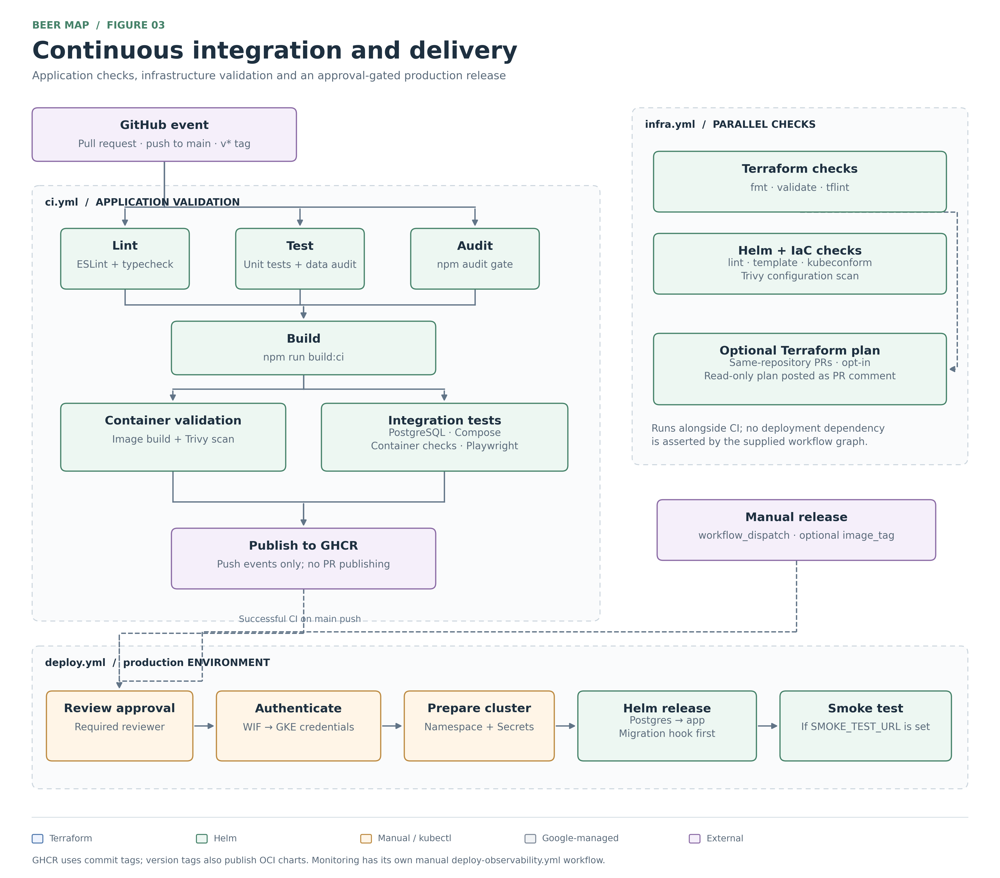
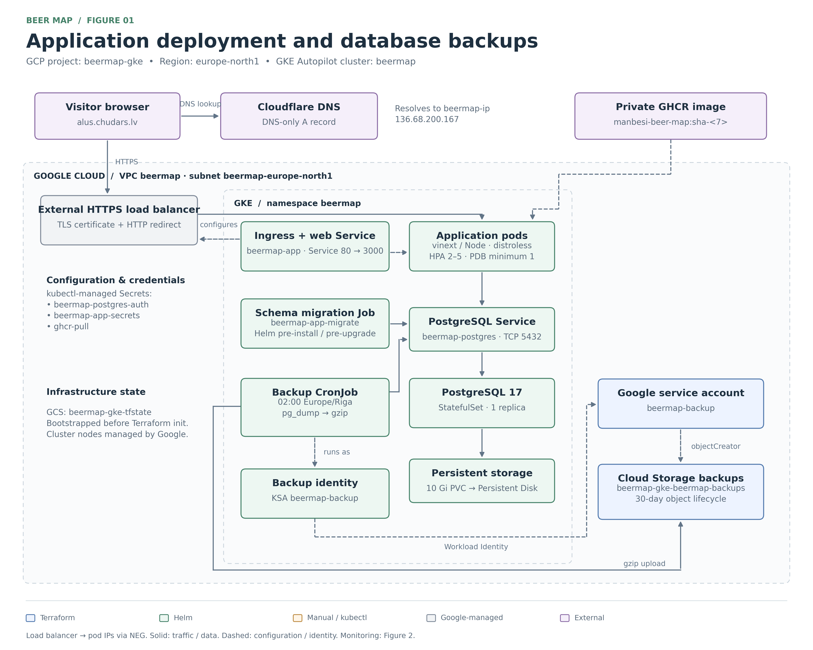
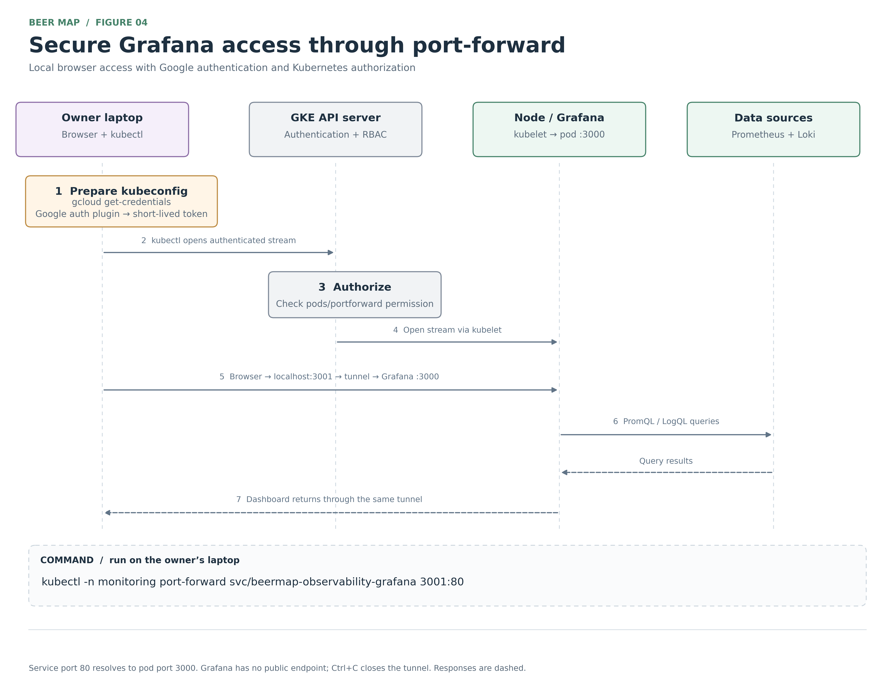

Jēkabs Čudars and Kristers Krīgers

# “Beer Map” DevOps Final Project

## What we built

We built Rīgas alus karte, a website for finding and comparing beer prices in Riga. Visitors can search for venues and beers, filter by price, compare the cheapest glass or liter, and open a venue’s full menu. A time slider shows opening status at the selected time on desktop and mobile. Users can suggest price changes, while admins approve, reject or reverse updates.

The website has a DevOps setup with Docker, automated checks, Terraform, Helm and monitoring. Application code, researched data, infrastructure, tests and documentation are organized in separate folders. GitHub holds the source, reviews, workflows and release packages; the app runs in a hosting environment.

## How architecture works

### Frontend

React and TypeScript build the interface, and MapLibre renders the map. The browser requests venues through /api/venues and uses them for search, price comparisons, menus and opening times. Catalog refreshes show approved prices without a new build.

### Backend and data

Vinext runs the frontend and REST API in one application container. PostgreSQL runs separately and stores the catalog, suggestions, published prices, admin permissions and audit history. The API also supports a sourced file catalog when PostgreSQL is not configured. Suggestions are validated and stored as pending; approval publishes the price, rejection leaves it unchanged, and reversal removes the override. Transactions, revision checks and retry identifiers protect updates. Clerk manages admin passwords and authenticator MFA; the backend checks the session and database allowlist before allowing reviews.

### Infrastructure and deployment

A Github Actions pipeline packages the app in a Docker image for later deployment, and Docker Compose stacks can be used to run the app with the database locally. For the cloud deployment, Terraform defines GKE Autopilot and supporting GCP resources. On GKE, Kubernetes runs the workloads; Helm charts are used to define app deployments, database storage, migrations, networking and scaling. GitHub Actions tests, builds and deploys releases. The repository also has a separate Cloudflare Worker hosting path, as the app was hosted originally there.

The following chart shows, how the pipeline works with all the non-linear actions,

The following chart describes the whole architecture of how our app is deployed on GKE, and the services it relies on.

### Monitoring and recovery

Prometheus collects workload metrics, Grafana displays dashboards, and Alloy sends container logs to Loki. Alert manager handles alert routing. A Grafana dashboard can be accessed via localhost, but a kubectl has to be authenticated for the project using a gcloud cli, so the gcloud can port forward the service to the localhost. A Kubernetes backup job exports PostgreSQL to GCS. Helm packages this monitoring stack separately from the app and database.

Here is a more detailed example of how connecting to Grafana works:

## Key design decisions

The original idea was a platform that could investigate incidents with HolmesGPT and suggest a recovery action for human approval. That is why we planned Kubernetes together with metrics, logs and monitoring: the platform would need information about what had gone wrong before suggesting a fix. We also had little real hands-on experience with Kubernetes, Terraform and Helm, so we wanted to use this project to learn how they work together on an actual application.

We chose GKE Autopilot because we wanted to learn how to deploy applications in one of the mainstream clouds. Moreover, we wanted to spend more time working with deployments and less time managing the couple of VPS. Terraform and Helm gave us a way to keep the setup in files that we could review and repeat. There was already plenty to learn, so we kept the frontend and API in one container rather than adding another service to manage. Docker let us try the application and database locally before dealing with the cloud setup.

We also wanted the database to have a real purpose in the app. Price suggestions and admin reviews gave us that: someone submits a change, an admin checks it, and the published price changes without being rebuilt. PostgreSQL supports keeping those related records consistent and saving the review history. For login, we used Clerk so we could demonstrate individual admin accounts and MFA without building password and authenticator management ourselves.

## How we check and deliver changes

A pull request runs application checks, unit tests, data audits, dependency checks and bundle budgets. PostgreSQL integration tests cover migrations, permissions and competing updates. Playwright checks actual browser interactions and suggestion persistence. Terraform and Helm have their own validation, and Trivy scans container and infrastructure configuration.

After the required jobs pass, main and release builds publish images to GHCR with tags that identify the version. Release tags also publish Helm charts. The deployment workflow uses the checked commit, authenticates to GCP through Workload Identity Federation, installs the database and upgrades the app. Migrations run before the app upgrade. Helm waits for readiness and rolls back a failed release. For the demonstration, the important flow is submitting a suggestion, approving it as an admin, and seeing the map update, alongside showing the checks, release and monitoring.

## Limitations and trade offs

The first limitation was our original scope, since we wanted to build the app, cloud delivery, monitoring and the HolmesGPT recovery workflow in one project. Each part turned out to have more details than we expected, especially with tools we were still learning. Near the end, we reduced the scope and dropped HolmesGPT, distributed tracing and SonarQube. We kept GKE, Terraform, Helm and monitoring, but gave up the self-healing part of the original idea.

The second trade-off was choosing a more complicated platform for the learning experience. Kubernetes, Terraform and Helm gave us useful practice and a setup we could rebuild, but they also meant more configuration, debugging and cloud costs than this small website would need on simpler hosting. Autopilot reduced some of that work, although it gave us less control over the underlying nodes. This choice made sense for our DevOps project, but it would need reconsidering if running the website cheaply were the only goal.

The third trade-off was keeping the database setup small. One PostgreSQL instance was easier to understand and manage, but the app still depends on that single instance being available. Backups help with recovery; they do not keep the database running through an outage. Rolling back the application also does not undo a database migration. A restore exercise is therefore needed before we can claim that recovery is proven.

## Use of AI-assisted tools

We used Codex and Claude a fair bit while building this system. As bachelor students on Erasmus+ exchange, we had limited experience with some of these technologies, but we were eager to learn and challenge ourselves. Because of the technical difficulty and gaps in our knowledge, we needed AI support to understand unfamiliar concepts and work through problems.

The main decisions came from us, for example we planned the initial architecture, the app logic and how the workflows should connect, then used AI to help turn those ideas into an implementation. This included generating parts of the app, database setup, authentication, Docker, Terraform, Helm and tests. We also used AI to explain errors, review changes and suggest fixes, but we still had to check its suggestions against what we wanted the system to do.

A substantial part of the work was hands-on. We went through the Terraform files and Kubernetes configuration, checked resource definitions and settings, and worked on getting the application, database and deployment parts to fit together. We set up accounts and permissions, configured authentication and tested the interface ourselves. When something failed or behaved unexpectedly, we investigated it, adjusted the setup and tested again.

We did not simply accept generated files because they looked complete. We reviewed them against our intended system and used automated checks, database tests and browser tests to see what actually worked. AI helped with coding and troubleshooting, while our manual setup, review, testing and corrections were essential to getting the system running.
